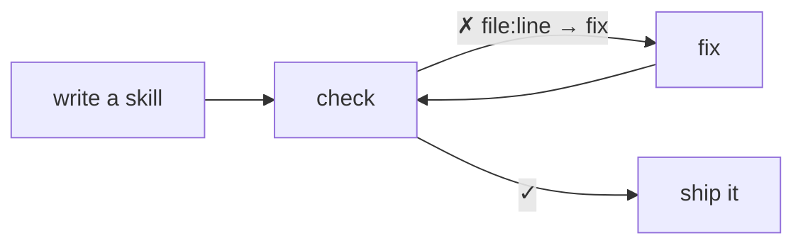

# hexagonal-skill-builder

A linter and writing guide for [Agent Skills](https://code.claude.com/docs/en/skills), the
`SKILL.md` folders that Claude Code and other coding agents load. Write skills that do what they
say, and check them against four rules a script can hold. Every finding comes with its file, its
line and its fix.

A skill is a set of instructions a model follows to the letter, so how it is organised is how it
behaves. A link to a page that moved sends it nowhere, a long entry is paid for on every call, and a
script nobody tests was only ever watched.

## At a glance

| Question               | Answer                                                                          |
| ---------------------- | ------------------------------------------------------------------------------- |
| What is it?            | A linter for Agent Skills (`SKILL.md`), and a guide Claude follows to write one |
| What does it check?    | Four rules: `named`, `small`, `resolves`, `tested`                              |
| Where does it run?     | Claude Code, any agent the skills CLI supports, CI, and commit hooks            |
| How do I install it?   | `/plugin install arnaud-zg --marketplace arnaud-zg/configs`                     |
| How do I call it?      | Ask Claude to _check the skills_, or type `/arnaud-zg:hexagonal-skill-builder`  |
| How do I run it in CI? | `node <skill folder>/scripts/check.mjs`, which exits `1` on a finding           |
| What does it need?     | Node. No dependencies, no network, and it never writes a file                   |
| Which plugin ships it? | `arnaud-zg`, from the `arnaud-zg` marketplace in `arnaud-zg/configs`            |
| What is the license?   | MIT                                                                             |

## 📚 Documentation

- 🚀 **[Tutorial](docs/tutorial.md)**: your first skill, checked, in ten minutes.
- 🛠️ **[How-to guides](docs/how-to.md)**: check one skill, fail a build, require tests, read the
  JSON, split a long entry.
- 📖 **[Reference](docs/reference.md)**: the command, its exit codes, and exactly what each rule
  looks for.
- 💡 **[Explanation](docs/explanation.md)**: why a skill's shape is its behaviour, and why four
  rules.



## Install

**Claude Code**, in one step (Claude Code 2.1.275 or later):

```sh
/plugin install arnaud-zg --marketplace arnaud-zg/configs
```

or in two, pinned to the version you reviewed:

```sh
/plugin marketplace add arnaud-zg/configs#arnaud-zg--v0.2.0
/plugin install arnaud-zg@arnaud-zg
```

**Any agent**, with the [skills CLI](https://github.com/vercel-labs/skills):

```sh
npx skills add arnaud-zg/configs --skill hexagonal-skill-builder
```

or pinned, through the release's tag:

```sh
npx skills add https://github.com/arnaud-zg/configs/tree/arnaud-zg--v0.2.0 --skill hexagonal-skill-builder
```

**A whole team**, from the project's `.claude/settings.json`. Everyone who trusts the folder gets
the marketplace, and the plugin turns on at their next session:

```json
{
  "extraKnownMarketplaces": {
    "arnaud-zg": {
      "source": {
        "source": "github",
        "repo": "arnaud-zg/configs",
        "ref": "arnaud-zg--v0.2.0"
      }
    }
  },
  "enabledPlugins": { "arnaud-zg@arnaud-zg": true }
}
```

## Use it

Ask Claude to _check the skills_, or to _create a skill_ for something, and the skill fires on its
own. To call it by name, use `/arnaud-zg:hexagonal-skill-builder check` (from the `arnaud-zg`
plugin) or `/hexagonal-skill-builder check` (from the skills CLI).

The check is a Node script, and runs without Claude too:

```sh
node <skill folder>/scripts/check.mjs [path ...] [--suite <script>] [--json]
```

On a project with one skill that holds and one that does not:

```text
Checking 2 skills against named, small, resolves, tested

.claude/skills
  ✓ release-notes
  ✗ tidy-imports
      .claude/skills/tidy-imports/SKILL.md:3  named
      the description never says when to use the skill
      → add a "Use when …" sentence with the words a person would type
      .claude/skills/tidy-imports/scripts/sort.mjs:1  tested
      scripts/sort.mjs is reached by no test
      → write a test that imports or runs it

✗ 2 findings in 1 of 2 skills.
```

It exits 0 when every skill holds, 1 on a finding, and 2 when there is nothing to check, so it can
gate a commit hook or a CI job as it is.

## The four rules

| Rule       | Says                                                                                    |
| ---------- | --------------------------------------------------------------------------------------- |
| `named`    | `SKILL.md` is named for its folder in lowercase-hyphen words, and says when to use it   |
| `small`    | the entry's body fits in 150 lines, and every other page in 300                         |
| `resolves` | every relative link, heading anchor, `${CLAUDE_SKILL_DIR}` path and cited story exists  |
| `tested`   | every script under `scripts/` is reached by a test; with `--suite`, every test is in it |

Each one is there because a skill once broke it and a model followed it anyway. The stories are in
[`evidence.md`](skills/hexagonal-skill-builder/evidence.md), and seven mistakes no script can see
are in [`guards.md`](skills/hexagonal-skill-builder/guards.md).

## Questions

### How do I lint or validate a `SKILL.md` file?

Ask Claude to _check the skills_, or run `node <skill folder>/scripts/check.mjs`. With no path, it
checks every skill in `.claude/skills`, `.agents/skills`, `skills/` and `plugins/*/skills`. Pass a
path to check one skill or one folder.

### How do I check Agent Skills in CI or a commit hook?

Copy the skill into the project with the skills CLI, then run the check in a job. It exits `0` when
every skill holds and `1` on a finding.
[Fail a build when a skill breaks](docs/how-to.md#fail-a-build-when-a-skill-breaks) has a CI step
and a Lefthook hook to copy.

### Does it work outside Claude Code?

Yes. `npx skills add arnaud-zg/configs --skill hexagonal-skill-builder` installs it in any agent the
[skills CLI](https://github.com/vercel-labs/skills) supports, and the check is a plain Node script
that needs no agent at all.

### How is it different from `claude plugin validate`?

`claude plugin validate` checks that a plugin's manifests are well-formed. This checks what is
inside each skill: its name and description, its length, that every link and path resolves, and that
every script is tested.

### Why is the skill called `/arnaud-zg:hexagonal-skill-builder`?

Claude Code names a plugin's skills `<plugin>:<skill>`. The plugin is `arnaud-zg`, which holds every
skill from this marketplace, and the skill is `hexagonal-skill-builder`. Installed with the skills
CLI, it is `/hexagonal-skill-builder`.

### Why "hexagonal"?

The entry, `SKILL.md`, is the one port a model reads, and every other page sits behind it by layer,
as in hexagonal architecture. [Why "hexagonal"](docs/explanation.md#why-hexagonal) says more.

## 🔒 Know what you're installing

- **It reads, and never writes.** The check reads the files under your skills folders and
  `package.json` when you pass `--suite`. It changes nothing and opens no connection.
- **It needs Node only**, with nothing to download, and ships no hooks and no MCP server.
- **It pre-approves one command**: `node ${CLAUDE_SKILL_DIR}/scripts/check.mjs`, through the skill's
  `allowed-tools`, so the check runs without a permission prompt. Everything else asks.

Read [`SKILL.md`](skills/hexagonal-skill-builder/SKILL.md) and
[`scripts/`](skills/hexagonal-skill-builder/scripts/) before you install it, as you would any
dependency. Claude reads `SKILL.md`, not this page.
